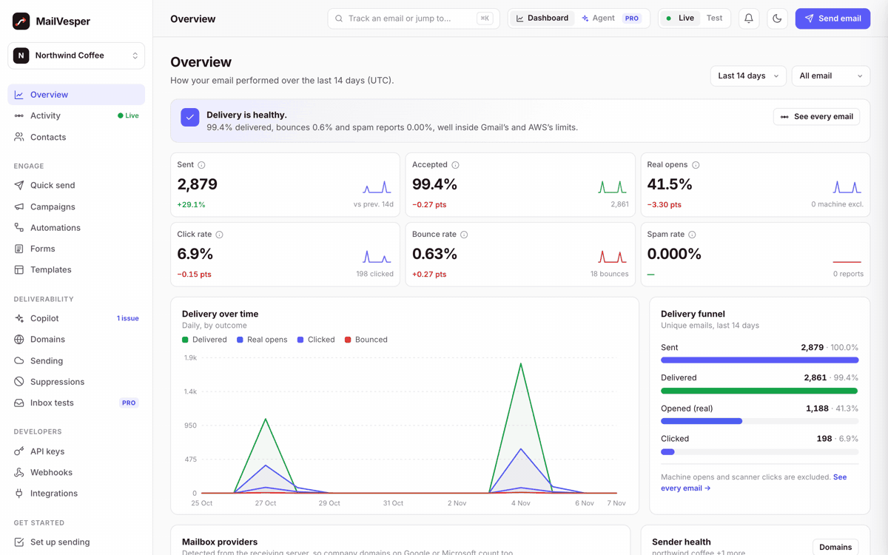
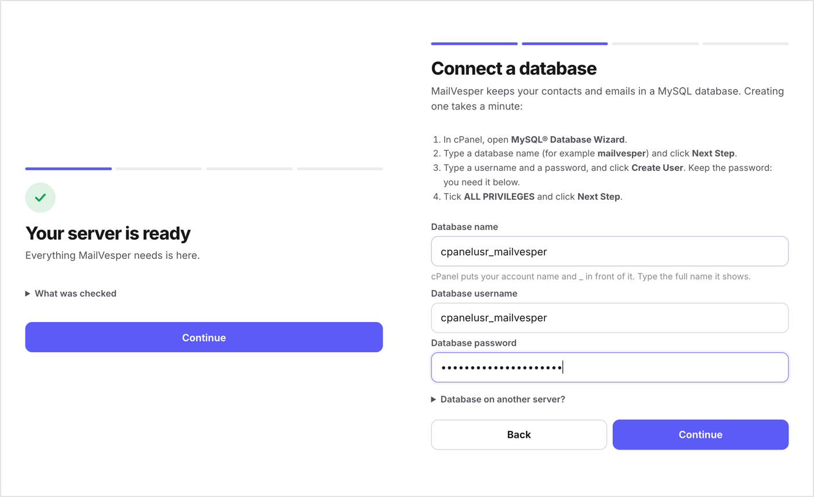
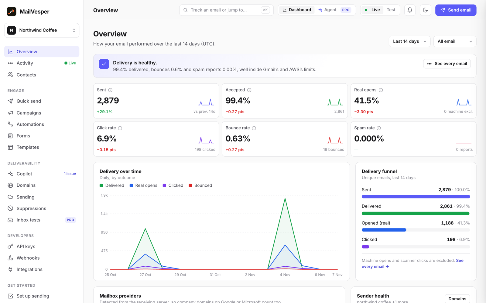
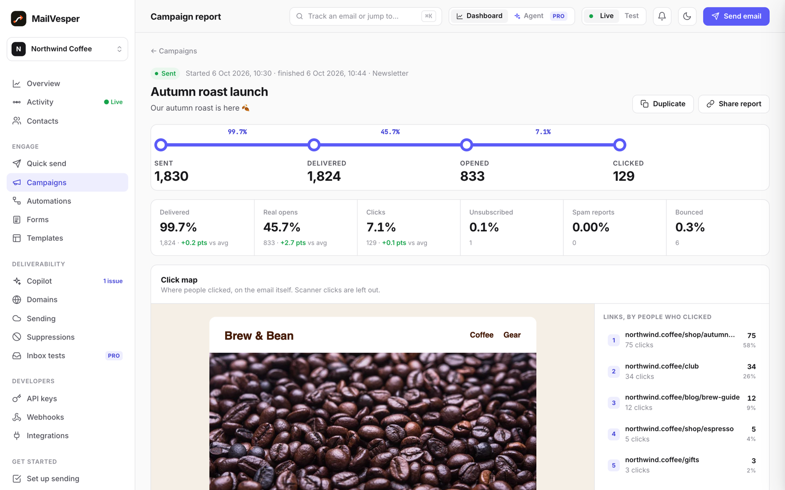
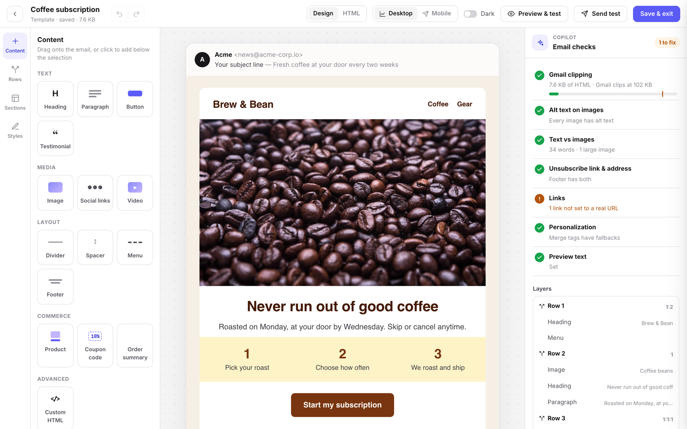
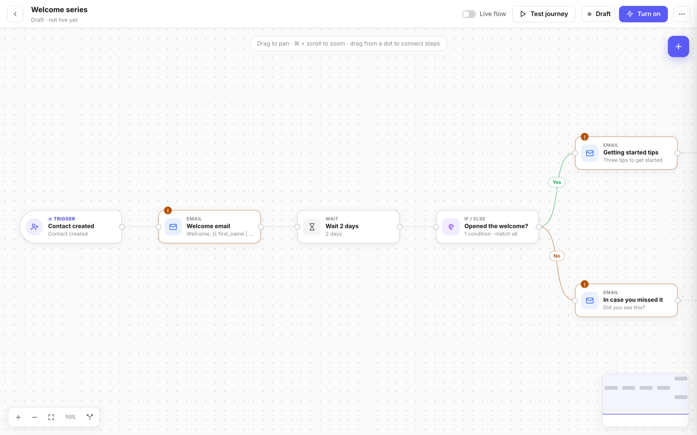
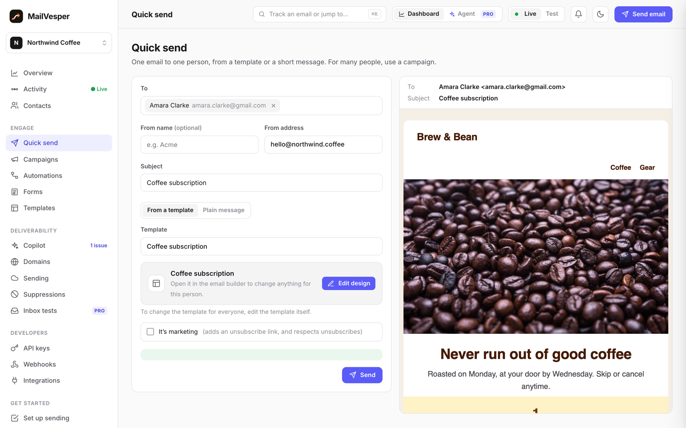
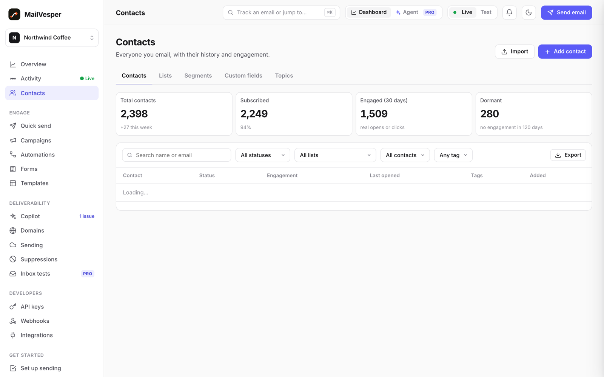
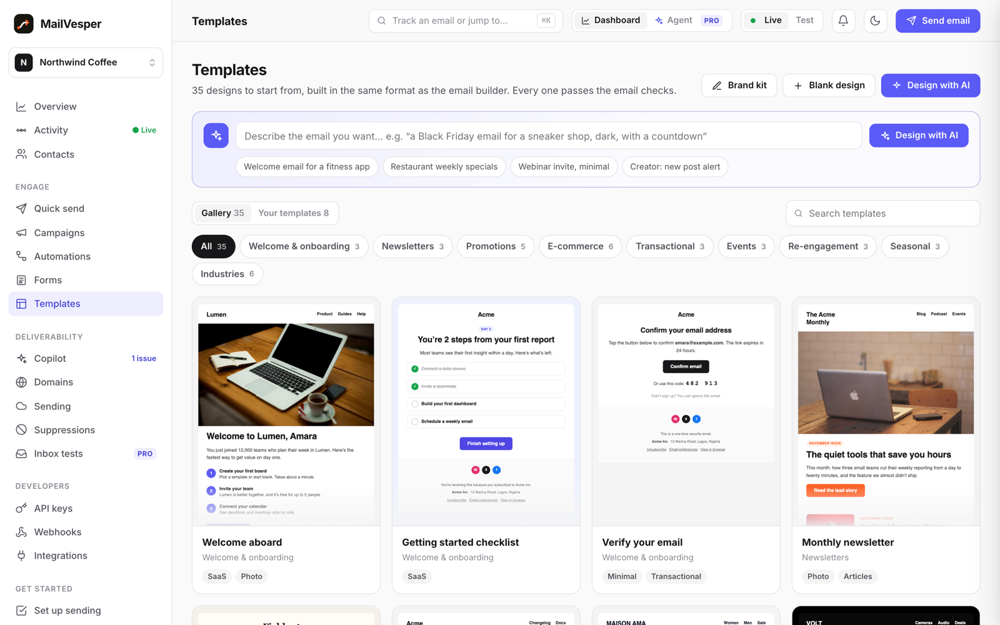
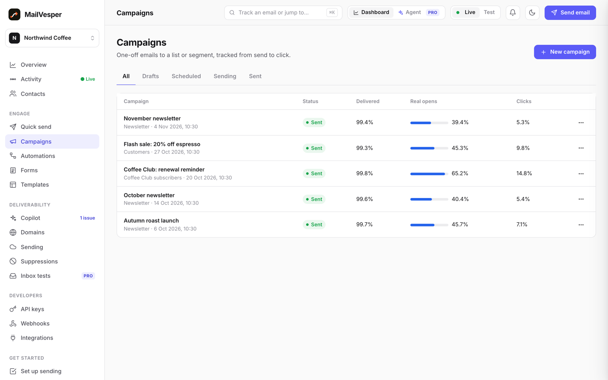

<div align="center">


# MailVesper

**Self-hosted email marketing. Your server, your contacts, your sending price.**

A free alternative to Mailchimp, Klaviyo and SendGrid that installs on ordinary cPanel hosting in a few minutes, from your browser. Send newsletters, campaigns, automations and transactional email through your own Amazon SES account or any SMTP server.

[](https://github.com/bopmack/mailvesper/releases/latest)
[](https://github.com/bopmack/mailvesper/stargazers)
[](INSTALL.md)
[](INSTALL.md)
[](LICENSE)

[**Download**](https://github.com/bopmack/mailvesper/releases/latest) · [Install guide](INSTALL.md) · [Features](#features) · [Screenshots](#screenshots) · [Contributing](CONTRIBUTING.md)

<br>



</div>

<br>

## Why MailVesper

- **No price per contact.** Hosted tools charge more as your list grows. MailVesper sends through your own Amazon SES or SMTP account, so you pay that provider's sending price and nothing per subscriber.
- **Your data stays with you.** Contacts, campaigns and reports live in your own MySQL database, on your own server.
- **Easy to install.** If your hosting has cPanel, you already have everything it needs: PHP, MySQL and a cron job. No terminal, no Docker, no Node.js.
- **Everything in one place.** A drag-and-drop email builder, campaigns, automations, contacts, deliverability checks and a REST API.

## Install in about five minutes



1. **Download** the latest `mailvesper-community-<version>.zip` from [Releases](https://github.com/bopmack/mailvesper/releases/latest).
2. **Upload and extract it** with cPanel's File Manager.
3. **Point a domain or subdomain** at the `mailvesper/public_html` folder.
4. **Open `https://your-domain/install/`** and follow the steps. The installer checks your server, connects the database (with cPanel instructions on screen), creates your admin account and shows you the one cron job to add.

[INSTALL.md](INSTALL.md) walks through every step. On a VPS with a terminal, you can install from the command line instead:

```sh
git clone https://github.com/bopmack/mailvesper.git
cd mailvesper/backend
composer install --no-dev --optimize-autoloader
php artisan mailvesper:install
```

**Requirements:** PHP 8.2+, MySQL 8 or MariaDB 10.6+, and a cron job. Nothing else.

## Features

| | |
|---|---|
| **Sending** | Amazon SES (guided setup, domains, DKIM, sandbox and reputation status) or any SMTP server: Gmail, Microsoft 365, SendGrid, Mailgun, Brevo, Postmark, Zoho or your own. Open and click tracking, bounce and complaint handling, suppressions. |
| **Email builder** | A drag-and-drop builder with 35 ready-made templates, mobile and dark-mode previews, and checks as you design (Gmail clipping, alt text, links, unsubscribe). **Design with AI** turns a short brief into an editable email. |
| **Campaigns** | Send to lists, segments or hand-picked contacts. Scheduling, sending in each contact's time zone, and A/B tests that pick their own winner. Reports with a click map. |
| **Quick send** | Send one email to one person from any template, and change the design just for them. |
| **Automations** | A visual journey editor with triggers, waits, if/else branches and goals. Ready-made recipes for a welcome series, abandoned checkout, win-back and birthdays. |
| **Contacts** | Lists, segments, custom fields, topics and subscription preferences, engagement scores and CSV import. Importers for Mailchimp, Klaviyo, Brevo, Kit, SendGrid and Mailgun. |
| **Forms** | Sign-up forms, pop-ups, slide-ins and bars, added to any site with one script tag. |
| **Deliverability** | A deliverability score, findings with fixes, and DMARC report reading. |
| **Developers** | A REST API with API keys: send one email or a batch, manage contacts and lists, webhooks, and events that start automations. The reference is built in at `/docs/`. |
| **Security** | Passkeys, two-step verification, email sign-in codes and an audit log. |
| **Running it** | A browser installer, nightly database backups, and a settings page for the system email, the AI key and sending limits. |

One admin login runs any number of workspaces: one per brand or company.

## Screenshots

<table>
  <tr>
    <td width="50%"><br><sub><b>Overview.</b> Delivery, real opens (machine opens left out), clicks and bounces.</sub></td>
    <td width="50%"><br><sub><b>Campaign report.</b> The funnel, rates against your average, and a click map.</sub></td>
  </tr>
  <tr>
    <td><br><sub><b>Email builder.</b> Drag and drop, with checks as you design.</sub></td>
    <td><br><sub><b>Automations.</b> A welcome series that follows up with people who didn't open.</sub></td>
  </tr>
  <tr>
    <td><br><sub><b>Quick send.</b> One person, any template, changed just for them.</sub></td>
    <td><br><sub><b>Contacts.</b> Lists, segments, fields and engagement.</sub></td>
  </tr>
  <tr>
    <td><br><sub><b>Templates.</b> Ready-made designs to start from.</sub></td>
    <td><br><sub><b>Campaigns.</b> Every send and how it did.</sub></td>
  </tr>
</table>

<sub>The screenshots use made-up demo data.</sub>

## ⭐ Like it? Star it

If MailVesper saves you money or time, **please star this repository**. Stars help other people find it, and they show us what to build next.

## Contributing

Contributions are welcome: bug reports, fixes, email templates and ideas.

- **Found a bug?** [Open an issue](https://github.com/bopmack/mailvesper/issues/new) with the steps to reproduce it.
- **Have an idea?** Open an issue to talk it through before writing the code.
- **Want to send a fix?** Read [CONTRIBUTING.md](CONTRIBUTING.md). The front end is plain JavaScript with no build step and the backend is Laravel 12, so it's quick to get going:

```sh
cd backend
composer install
cp .env.example .env && php artisan key:generate
composer check   # code style (Pint), static analysis (Larastan) and the tests (Pest)
```

Please report security problems privately, as [SECURITY.md](SECURITY.md) describes.

### Repository layout

| Path | What it is |
|---|---|
| `backend/` | The API (Laravel 12): everything under `/api` |
| `app/` | The application (plain JavaScript, no build step), served at `/app/` |
| `site/` | Login, API docs, unsubscribe and preference pages |
| `deploy-web/` | Security headers for the web folder |
| `docs/` | Extra guides and the screenshots |

## MailVesper Pro

Pro is a paid add-on, installed on top of Community and using the same database. It adds:

- team members and roles;
- the AI agent, Copilot chat and inbox placement tests;
- the Platform dashboard: system health, error log, alerts, backups with restore drills and off-site copies, more admins, social sign-in and white-label branding;
- SaaS mode, to sell plans to your own customers, with Stripe and Paystack billing.

Pro is also the license you need to run MailVesper for clients or as a paid service. Pro features show in Community as locked previews. See [licenses.fanstext.com](https://licenses.fanstext.com/).

**Want it installed for you?** We can install and set up MailVesper on your own server or hosting account. Get in touch through [licenses.fanstext.com](https://licenses.fanstext.com/).

## License

MailVesper Community is **free and source-available**, under the [PolyForm Internal Use License 1.0.0](LICENSE). In plain words:

- **You may** install it, run it and change it, for yourself and for your own company, including sending email to your own customers and subscribers.
- **You may not** sell it, resell it, run it for clients or other companies, offer it as a hosted service, or publish a changed copy outside this repository.

For anything else, including agencies and paid services, get [MailVesper Pro](https://licenses.fanstext.com/). The license text is the authority; this summary is only a guide. Third-party packages installed by Composer keep their own licenses.

<div align="center">
<br>
Copyright © 2026 Akintomide Ayodele
</div>
